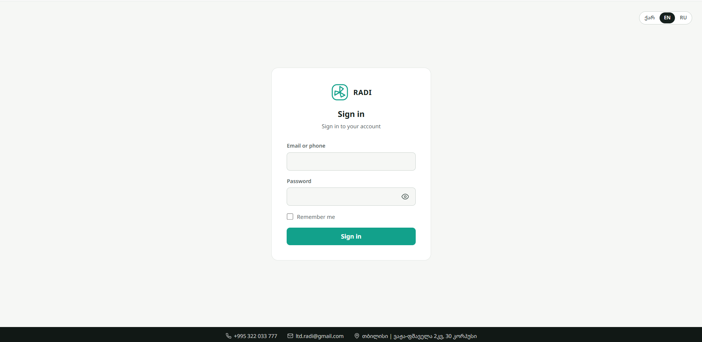
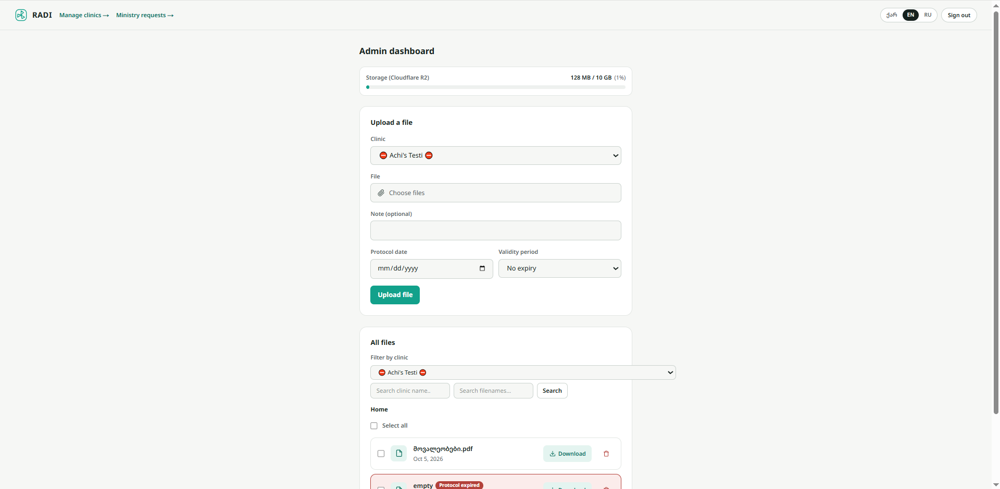
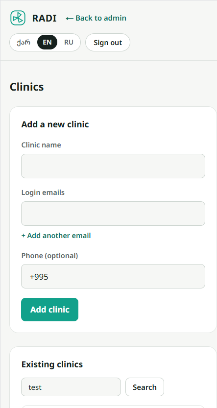

# Radi Inspection Services — Clinic Portal (Clinics.Radi.Ge):

Radi's file-sharing portal for the clinics we inspect, operating in Georgian, English and Russian. Admins upload inspection protocols and assign them to clinics, each clinic logs in and sees only its own documents.

Portal is built with **Next.js**, **TypeScript** and **Tailwind CSS v4**, uses **Supabase** for the database and logins, **Cloudflare R2** for file storage, and is deployed to/with **Cloudflare Workers**.

## Features:

- **Two roles: admin & clinic** access is checked in middleware and again in every server action, so a clinic can never reach another clinic's files.

- **File management** drag-and-drop batch upload, folders inside folders (any depth), select all / move / delete in bulk, paginated "all files" list with search by file name and clinic name.

- **Protocol expiry tracking** every file can have a protocol date and validity period (6 months – 3 years). Expired files turn red, and folders get a small red marker when anything inside them has expired. Clinics can press "გასაგებია" to acknowledge an expired file, which turns it from red to a softer amber on their side, admin keeps seeing red.

- **Batch dates** when uploading many files at once, one date and validity can be applied to all of them with one checkbox.

- **Clinic accounts** each clinic can have several logins (owner, radiologist, manager...), each with its own generated password. Logins can be added, reset or removed later.

- **Remember me** 30 day session when checked, otherwise logged out when the browser closes.

- **Storage meter** admin panel shows how much of the R2 free tier is used, turns amber at 70% and red at 90%.

- **Full i18n (ge / en / ru)** Georgian is the default language.

## How To start:

```bash
npm install
cp .env.example .env.local   # fill in Supabase and R2 values
npm run dev                  # http://localhost:3000
```

### Script:

| Command | Description |
|---|---|
| `npm run dev` | Starts dev server |
| `npm run build` | Builds production |
| `npm run lint` | ESLint |
| `npm run preview` | Build with OpenNext and run locally in Workers runtime |
| `npm run deploy` | Build and deploy to Cloudflare (Wrangler must be set up) |

### Environment:

| Variable | Description |
|---|---|
| `NEXT_PUBLIC_SUPABASE_URL` | Supabase project URL |
| `NEXT_PUBLIC_SUPABASE_ANON_KEY` | Supabase anon key |
| `SUPABASE_SERVICE_ROLE_KEY` | Server only, used for admin actions |
| `R2_ACCOUNT_ID` | Cloudflare account ID |
| `R2_BUCKET` | R2 bucket name |
| `R2_ACCESS_KEY_ID` / `R2_SECRET_ACCESS_KEY` | R2 API token (Object Read & Write) |

Same values go into `.dev.vars` for `npm run preview`, and into Worker secrets (`wrangler secret put`) for production.

### Database:

Supabase tables the portal expects:

- `clinics` — `id`, `name`, `phone`, `created_at`
- `profiles` — `id` (= auth user id), `role` (`admin` | `clinic`), `clinic_id`
- `files` — `id`, `clinic_id`, `filename`, `storage_path`, `storage_provider` (`supabase` | `r2`), `size_bytes`, `uploaded_by`, `uploaded_at`, `note`, `folder`, `protocol_date`, `validity_months`, `expiry_acknowledged_at`
- `ministry_submissions`, `ministry_submission_files`, `ministry_download_tokens` — ministry submission workflow

## Project structure:

```
src/
  app/
    login/                login page (email or phone + password, remember me)
    admin/                admin panel: upload, all files, folders, pagination
      clinics/            clinic accounts and logins
      ministry/           ministry submission requests
    dashboard/            clinic side: own files, folders, expiry acknowledge
    actions/              upload / download URL signing (shared)
    api/                  ministry download links
  components/             file list, folder view, breadcrumb, storage meter, ...
  lib/
    storage/              R2 + Supabase storage, picked per file
    supabase/             server / browser / middleware clients
    i18n/                 ka / en / ru translations
    folderPath.ts         nested folder helpers
    protocolExpiry.ts     expiry calculation
  middleware.ts           session refresh, role routing, remember me
wrangler.jsonc            cloudflare Worker configuration
open-next.config.ts       cloudflare adapter configuration
r2-cors.json              R2 bucket CORS rule (browser uploads)
```

## Engineering notes:

- **Why Next.js 15 and not 16:** Cloudflare adapter and Wrangler do not yet bundle Next.js 16 correctly (Node.js middleware is not supported), because of that the project is on Next.js 15, where the same code deploys cleanly.

- **Two storage backends:** older files live in Supabase Storage, every new upload goes to Cloudflare R2 (no egress fees). Each file row has `storage_provider`, so downloads and deletes go to the right place automatically and nothing had to be migrated.

- **Uploads go straight to R2:** the server checks who you are and signs a short-lived upload URL, the browser uploads the file directly to R2, so files never pass through the Worker.

- **No row-level security on R2:** download links are only created by a server action that checks admin / own clinic first.

- **Nested folders without a schema change:** folders are stored as a path in one text column (`2026/თებერვალი`), old flat folder names keep working as top-level folders.

- **Pagination:** the "all files" list is limited to 50 per page, rendering every file at once went over the Worker's CPU limit once the file count grew.

## Notes on content & copyright.

- Company name, branding and copy belong to Radi Inspection Services and are included here for portfolio and review purposes only.
- Contact details, domains and infrastructure names in this repository are replaced with placeholders. No real clinic data is included.

- Live Portal Copyright Is Owned by ltd Radi - All Rights Reserved.
- Live Portal Repository Is Owned by ltd Radi - All Rights Reserved.
- Code Copyright Is Owned By Archili Okroshidze (NOTACH122) - All Rights Reserved.

## Screenshots:

---

---

